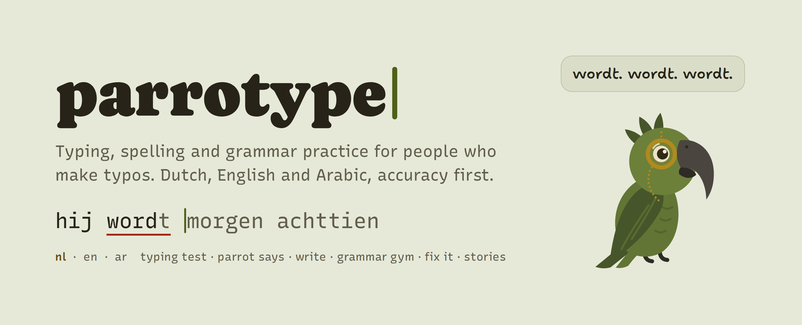
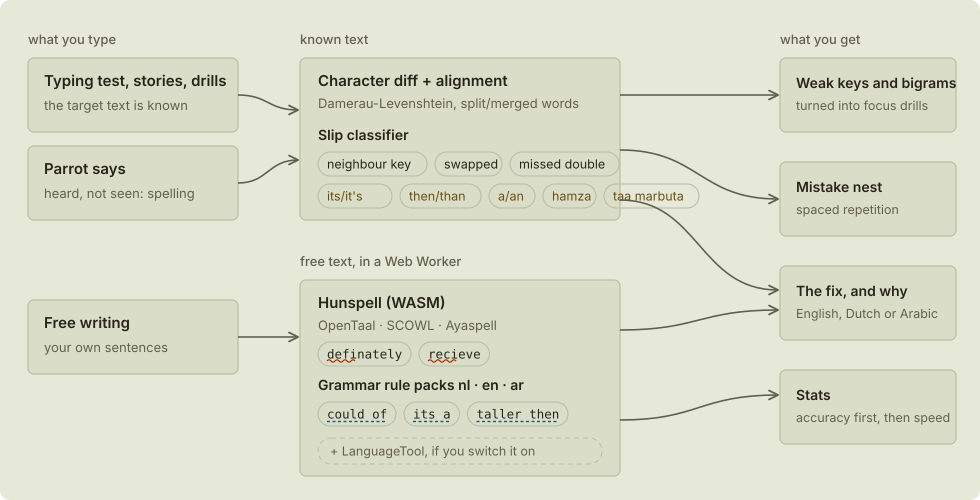
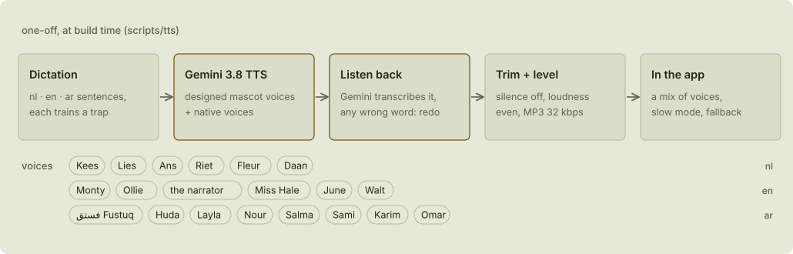

<p align="center">
  <picture>
    <source media="(prefers-color-scheme: dark)" srcset="docs/readme/hero-dark.png">
    
  </picture>
</p>

<p align="center">
  <b>Typing, spelling and grammar practice for people who make typos.</b><br>
  Dutch, English and Arabic. Accuracy first. Everything runs in your browser.
</p>

<p align="center">
  React 19 · TypeScript · Vite · Hunspell (WebAssembly) · hand-written grammar rules · Gemini 3.8 voices · no backend
</p>

---

## Why parrotype

Typos come in two kinds, and they need different training.

| | Finger slips | Spelling knowledge |
|---|---|---|
| **Looks like** | `teh`, `alllen`, a neighbouring key | `definately`, *then* for *than*, a Dutch verb ending that sounds right but is spelled wrong |
| **What helps** | adaptive drills on your weak keys and letter pairs, real words, a steady pace | hearing the word and spelling it yourself, short rule reminders, spaced repetition |
| **parrotype** | typing test, focus drills, weak-key heatmap | dictation, grammar drills, proofreading, free writing with feedback |

Every mistake is labelled as one or the other, so practice goes where it helps.
Copy-typing is literally parroting, which is where the mascot comes in: a kea, the world's only alpine parrot, with a monocle.
He has a name in every language: **Kees** in Dutch, **Monty** in English and **فستق Fustuq** (pistachio) in Arabic.

## Modes

<table>
  <tr>
    <td width="50%"></td>
    <td width="50%"></td>
  </tr>
  <tr>
    <td><b>Type</b> · <code>/</code><br>A Monkeytype-style test (time, words, quotes) with a smooth caret and focus mode. The interface fades while you type.</td>
    <td><b>Results</b><br>Speed, accuracy and consistency, plus each typo labelled (neighbour key, swapped letters, missed double, homophone) with a one-line tip.</td>
  </tr>
  <tr>
    <td></td>
    <td></td>
  </tr>
  <tr>
    <td><b>Parrot says</b> · <code>/listen</code><br>A recorded voice reads a sentence and you type it from hearing. First you are only told which words are wrong, then the letters, then the rule. You always end by typing the correct sentence once.</td>
    <td><b>Write</b> · <code>/write</code><br>Free writing from a prompt. Spelling (wavy) and grammar (dashed) underlines appear when you say you are done, after a short moment to find the mistakes yourself.</td>
  </tr>
  <tr>
    <td></td>
    <td></td>
  </tr>
  <tr>
    <td><b>Grammar gym</b> · <code>/gym</code><br>Quick rounds where you type the missing word: its/it's, then/than, a/an, Dutch verb endings and articles, Arabic hamza and taa marbuta, and more.</td>
    <td><b>Fix it</b> · <code>/fix</code><br>Short texts with planted mistakes to proofread. You see what you fixed, what you missed and what you broke, and you always end on the corrected text.</td>
  </tr>
  <tr>
    <td></td>
    <td></td>
  </tr>
  <tr>
    <td><b>Stories</b> · <code>/stories</code><br>Original short stories typed page by page. Arabic is right to left, with the letters kept joined while they change colour.</td>
    <td><b>Stats</b> · <code>/stats</code><br>Accuracy first, then speed. A keyboard heatmap, your most-missed words, the grammar rules you trip over, and a practice calendar.</td>
  </tr>
</table>

There is also **Weak spots** (`/practice`): drills built from your own weak keys and letter pairs, plus a *mistake nest* that brings back the words you got wrong on a spaced-repetition schedule. **Daily** (`/daily`) is one short challenge that stays the same all day.

## How mistakes are caught

<picture>
  <source media="(prefers-color-scheme: dark)" srcset="docs/readme/pipeline-dark.svg">
  
</picture>

- **Known text** (typing test, dictation, drills) is compared letter by letter, using an alignment that knows about swapped letters and words that were split or merged. A classifier then decides whether each slip was a finger or spelling knowledge.
- **Free text** is checked in a Web Worker. [Hunspell](https://hunspell.github.io/), compiled to WebAssembly, handles spelling (it understands Dutch compound words). Suggestions are re-ranked by word frequency and keyboard distance. Hand-written grammar rules then catch the mistakes a spell checker cannot see, because the wrong word is still a real word.
- **Every rule explains itself**, in English and in the practice language, with the fix. Each rule is also tested against sentences it must *not* flag: being corrected on correct text teaches the wrong thing.
- **Optional:** switch on [LanguageTool](https://languagetool.org) in settings for a second opinion, using the public server or your own.

| | Dutch | English | Arabic |
|---|---:|---:|---:|
| Grammar and spelling rules | 86 | 105 | 38 |
| Dictation sentences | 94 + 9 pair sets | 83 + 9 pair sets | 120 + 12 pair sets |
| Grammar gym packs | 13 | 12 | 12 |
| Writing prompts | 44 | 37 | 37 |
| Stories | 4 | 4 | 5 |
| Quotes and proverbs | 67 | 54 | 36 |
| Recorded voices | 6 | 6 | 8 |

## The voices

<picture>
  <source media="(prefers-color-scheme: dark)" srcset="docs/readme/voices-dark.svg">
  
</picture>

Each dictation sentence is pre-recorded with **Gemini 3.8 Flash TTS**, in 20 voices across the three languages. The mascot's three voices were made with Gemini's *voice design*, from a written description of a cheeky kea with a monocle. The others are native-speaker voices from Gemini's voice library, picked for clarity.

Every clip is transcribed back by Gemini and compared word by word with the sentence. A clip with a missing, extra or changed word (or a stutter) is thrown away and recorded again. By default the app mixes the voices, and you can pick one in settings. Slow mode plays at 0.7× without changing the pitch. Sentences without a recording fall back to the browser's own speech.

The mascot also has a few short recorded lines for rare moments, such as a personal best or a streak. You can switch them off.

## Quick start

```bash
npm install
npm run dev        # http://localhost:5173
npm test           # unit tests (vitest)
npm run build      # type-check and production build into dist/
npm run preview    # serve the production build
```

Node 20 or newer. The `predev` and `prebuild` scripts copy the Hunspell dictionaries into `public/dicts`.

## Deploy to Vercel

parrotype is a static Vite app, so there is nothing to configure.

1. Import the repository at [vercel.com/new](https://vercel.com/new).
2. Vercel detects **Vite**: build command `npm run build`, output directory `dist`.
3. Deploy.

`vercel.json` rewrites every route to `index.html` for client-side routing and sets long cache headers for hashed assets and dictionaries. `api/languagetool.ts` is an optional serverless proxy for the LanguageTool check, so the browser never depends on CORS.

## Project layout

```
src/
  engine/       typing session state machine, metrics, typo classifier, alignment, drills (pure TypeScript)
  checker/      tokenizer, rule engine, rule packs (nl/en/ar), Hunspell worker, LanguageTool client
  features/     one folder per mode: typing, dictation, write, gym, proofread, stories, practice, stats, settings, about
  components/   ui kit, app shell, the kea mascot (inline SVG with a small state machine)
  content/      word lists, quotes, dictation sentences, prompts, drills, stories, proofreading texts
  lib/          router, speech, recorded audio playback, mascot names
  state/        zustand stores: settings, stats, mistake nest
  styles/       themes (colours taken from real parrots) and global styles
public/audio/   pre-recorded dictation clips and manifest.json
scripts/tts/    voice generation: personas, Batch API runner, transcription check
docs/           design brief and research reports
```

## Regenerating the voices

The clips are committed, so you only need this after changing dictation sentences.

```bash
export GEMINI_API_KEY=...          # read from the environment only, never commit it
npx tsx scripts/tts/dictation-jobs.ts > jobs.json
node scripts/tts/batch.mjs --jobs jobs.json --verify-existing
node scripts/tts/manifest.mjs
```

Clips whose sentence text changed are regenerated automatically. `scripts/tts/verified.json` records which clips passed the transcription check.

## Design

parrotype takes after Monkeytype's restraint: the typing text is the hero, and the interface gets out of the way. The colours come from real parrots (kea, rainbow lorikeet, scarlet macaw), in light and dark versions that pass WCAG AA contrast. Mistakes are always shown with colour and a shape (underline, strike-through), never with colour alone. The fonts are Recursive for typing, Caprasimo for the wordmark and Noto Naskh Arabic. Animation is reserved for rare moments: the mascot shows his orange underwing only when you set a personal best.

The research behind these choices is in [`docs/research/`](docs/research/): typing pedagogy, common Dutch, English and Arabic mistakes, a Monkeytype teardown, how to avoid a generic AI-made look, the tech stack and content design.

## Credits and licences

- Word frequencies: [hermitdave/FrequencyWords](https://github.com/hermitdave/FrequencyWords) (CC BY-SA 4.0)
- Dutch dictionary: [OpenTaal](https://www.opentaal.org/) via [wooorm/dictionaries](https://github.com/wooorm/dictionaries) (BSD-3-Clause or CC BY 3.0)
- English dictionaries: SCOWL via wooorm/dictionaries (MIT and BSD)
- Arabic dictionary: [Ayaspell](http://ayaspell.sourceforge.net/) (used under MPL-1.1), see `vendor/dicts/ar/LICENSE.md`
- Spell engine: [hunspell-wasm](https://www.npmjs.com/package/hunspell-wasm) (used under MPL-1.1)
- Voices: generated with Gemini 3.8 Flash TTS (audio carries Google's SynthID watermark)
- Fonts (SIL OFL 1.1): Recursive, Caprasimo, Shantell Sans, Noto Naskh Arabic, Atkinson Hyperlegible Mono, IBM Plex Mono
